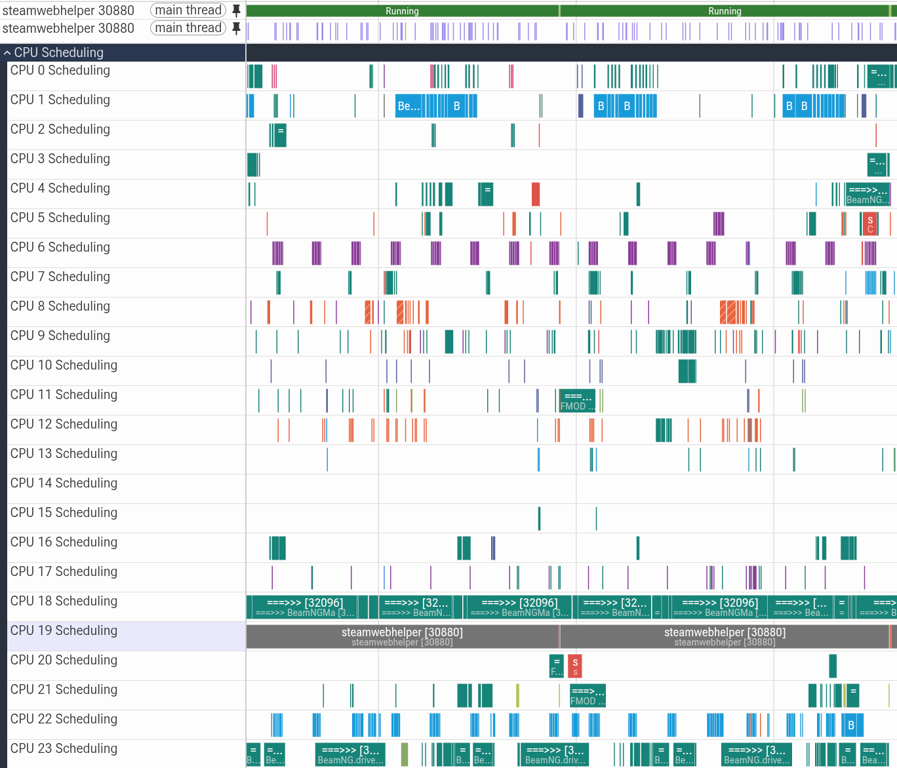

# Retroft


Retroft is a triggered ftrace recorder for embedded Linux systems. It keeps
recent execution history in per-CPU kernel buffers and saves it when an
application sends a trigger, preserving the lead-up to an intermittent fault
or missed deadline without continuously writing traces to storage.

The Rust recorder uses configurable memory budgets and a nonblocking trigger
client for latency-sensitive applications. Decoding and Perfetto export run
offline, keeping analysis dependencies off the embedded target. The same tools
also work on a development workstation for testing and tuning captures.

Retroft uses one thread, a fixed staging pool, and snapshot buffer swapping.
It writes and syncs captures through io_uring, checks records with CRC32C,
and compresses trace data with linked LZ4 blocks by default. Decoding runs offline.

The recorder inherits scheduling policy and priority from its launcher. The
provided systemd service sets `Nice=19` and `CPUSchedulingPolicy=other`;
direct invocation leaves the launcher's settings intact.

## Build and check

Use a recent stable Rust toolchain. Builds with LZ4 need a C compiler for
its bundled library. No matching kernel source tree, liburing, libtracefs, or
libtraceevent development package is needed.

Build all tools on the development or offline analysis machine:

```sh
cargo build --release --workspace
cargo test --workspace --all-targets
cargo clippy --workspace --all-targets -- -D warnings
python3 tests/check_dependencies.py
```

For a recording machine, build the recorder and optionally its small
trigger client:

```sh
cargo build --release -p retroft
cargo build --release -p retroft-trigger
```

The workspace's default member is the recorder, so plain `cargo build`
also excludes the offline tools. The packages are:

| Package | Role / executables |
| --- | --- |
| `retroft-format` | Shared container headers and record writer; no offline decoder. |
| `retroft` | Linux daemon, `retroft`. |
| `retroft-trigger` | Optional socket client, `retroft-trigger`. |
| `retroft-export` | Host validator and Perfetto exporter, `retroft-validate` and `retroft-export`. |

The executables are under `target/release/`. The tests exercise
container recovery, compression, trigger behavior, raw decoding, legacy mmap
frontiers, and storage ordering. The real io_uring test reports a skip if
the running sandbox/kernel denies io_uring; a skip is not live validation.

Recorder LZ4 support is an optional compile feature enabled by default.
For a recorder without that dependency:

```sh
cargo build --release -p retroft --no-default-features
```

Such a build defaults to uncompressed recording and rejects `--compression lz4`
before configuring tracing. Omitting the feature
does not restrict raw captures; the offline exporter still reads both raw
and compressed files. Building the exporter is a separate host operation.

For an optional system installation, run this command yourself:

```sh
sudo install -m 0755 target/release/retroft /usr/local/bin/retroft
sudo install -m 0755 target/release/retroft-trigger /usr/local/bin/retroft-trigger
```

Install `retroft-trigger` only where needed; the host offline tools can run
directly from their build directory. These commands do not start a service.
An optional [sample systemd unit](packaging/retroft.service) is
provided for review and adaptation after a successful foreground run. It uses
`Type=notify`: readiness is sent only after the trigger socket, tracing, and
storage initialization succeed. The supplied service requires the
[socket unit](packaging/retroft.socket), so systemd owns the socket and retains
queued triggers across service restarts. Socket activation is optional for Retroft
itself: standalone invocations create their own socket. Keep the service enabled
at boot so tracing history accumulates before the first trigger.
The daemon runs in the foreground and handles SIGINT/SIGTERM for orderly
shutdown: it stops reading new triggers, finishes accepted captures and
outstanding writes/syncs, then tears down its instance. A requested future
endpoint is shortened to shutdown time. Request reads pause during storage
backpressure and after the End record seals a capture. Use your service manager
to supervise `retroft`. Unread requests have no acceptance guarantee;
clients receive no acknowledgments.

## Kernel requirements

Run on Linux with tracefs, dedicated tracing instances, per-CPU
`snapshot_raw`, snapshot buffer swapping, the selected tracepoints, the `mono` trace clock, and
io_uring enabled and permitted. Typical configurations include
`CONFIG_TRACING`, `CONFIG_RING_BUFFER`, `CONFIG_TRACEPOINTS`, `CONFIG_FTRACE`,
`CONFIG_TRACER_SNAPSHOT`, and `CONFIG_IO_URING`. Capability checks use interfaces rather than a kernel
version cutoff. Both PREEMPT_RT and ordinary kernels are intended targets.

Snapshot support is required; there is no live-buffer fallback. The recorder
preallocates a spare ring and reads frozen data through `snapshot_raw`.
Build one binary per target architecture (x86-64, AArch64, ARM32). Cross
compilation needs the appropriate Rust target and C linker, not headers
matching each running kernel.

The recorder does not mount or remount tracefs, change unrelated tracing
instances, or modify eBPF instrumentation. Startup reports inaccessible
tracefs, missing events/clocks, unsupported geometry, and io_uring errors.
See [kernel investigation](docs/kernel-notes.md) and
[backend contract](docs/tracefs.md) for evidence and ABI details.

## Capture a workload

For a normal capture, create the output directory and start the recorder:

```sh
mkdir -p -m 700 captures
sudo ./target/release/retroft
```

Run your workload, let history accumulate, then trigger from another terminal:

```sh
sudo ./target/release/retroft-trigger --description "interesting moment"
```

The recorder prints the completed `.retroft` path under `./captures/`. Export
that file with `retroft-export FILE.retroft --output trace.pftrace` and open it
in [Perfetto](https://ui.perfetto.dev/).

Defaults use snapshot capture, record scheduler and
process-lifecycle events, allocate two 4 MiB banks per CPU, use 8 MiB of staging, compress
with LZ4, and sync batches of 8 MiB of stored data during a capture. Buffer size bounds memory,
not history duration: use `--idle-report 5s` to inspect retention and increase
`--buffer-per-cpu` if needed. The socket is `/run/retroft.sock`, restricted to
the daemon owner; the automatically named tracefs instance isolates its settings.
Idle reports and higher-volume interrupt/lock events remain opt-in.

The examples below explicitly select paths.
Run the following privileged commands yourself on the development machine.
These examples use the existing `/sys/kernel/tracing` mount. Start with
the recorder in one terminal:

```sh
mkdir -p -m 700 captures/read
sudo ./target/release/retroft \
  --instance retroft-read \
  --socket /run/retroft-read.sock \
  --output captures/read \
  --buffer-per-cpu 4MiB
```

Wait for `ready:`. Run a game or other workload normally, allow history to
accumulate, and trigger from another terminal:

```sh
sudo ./target/release/retroft-trigger \
  --socket /run/retroft-read.sock \
  --description "desktop workload" \
  --post 500ms
```

The client reports local queuing, without waiting for acceptance. The recorder
assigns trigger sequences when processing valid datagrams, and those sequences
appear in the capture. `--post` supplies a future CLOCK_MONOTONIC endpoint;
omitting it uses daemon processing time. Backpressure can delay processing and
shift the marker from the application's original event time.
`--end-timestamp-ns` accepts an absolute decimal CLOCK_MONOTONIC timestamp instead.
The shell client defaults to source `retroft-trigger`; use `--source` to identify
a component or service. Critical processes should prepare an unconnected
`NonblockingClient` and `PreparedTrigger` during initialization, then attempt one
nonblocking datagram send. There is no per-trigger connect or reply.

The daemon logs each accepted trigger with its source, PID, and description.
`capture started` names the new file; `capture extended` reports the endpoint
extension, or `capture trigger added` indicates an unchanged endpoint.
`remaining` is the time from trigger admission to the requested endpoint, not an
estimate of drain or disk-write time. Completion reports the file size in MiB,
trigger count, and elapsed processing time through the final file sync.
Elapsed time is not the duration of the retained trace history.

Wait for `capture complete:` and use the `.retroft` path printed at capture start:

```sh
./target/release/retroft-validate captures/read/SESSION/TIME_WORDS_INDEX.retroft
./target/release/retroft-export captures/read/SESSION/TIME_WORDS_INDEX.retroft \
  --output desktop-read.pftrace
```

Replace `SESSION/TIME_WORDS_INDEX.retroft` with the actual session directory
and capture filename printed by the recorder. These offline commands
need no tracing privileges, only permission to read the capture and write
the output. For analysis on another machine, transfer the `.retroft` file to the
analysis machine and run these tools there. Open `desktop-read.pftrace` in
[Perfetto UI](https://ui.perfetto.dev/).



Export reports decoded events, recovered time bounds, and available losses.
Its JSON summary separates `warnings` (issues identified for this export) from
`limitations` (general caveats about process identity sampling and approximate
UTC mapping; these do not indicate detected trace faults).
The exported file embeds the absolute input capture paths on the export machine,
in input order. Find them in Perfetto's trace metadata as
`cr-retroft.source_capture_paths` (a JSON array of paths).
Accounting snapshots appear as `Capture start` and `Capture end` markers, with
expandable diagnostic arguments instead of JSON event names. Redundant raw
statistics text remains in the capture but is omitted from Perfetto arguments.
New captures also preserve the recording kernel's release for Perfetto's
version-dependent preemption/idle-state decoding; exports of older captures
without it warn that these labels may be inaccurate.

CPU buffers can retain different amounts of history. Export automatically supplies
Perfetto's per-CPU start-boundary hints, using each CPU's first retained event.
Perfetto (v47+) starts derived scheduling and thread-state analysis where those
histories overlap, avoiding false long runnable intervals across missing leading
history. Before exporting, it also removes disconnected leading history: for
each CPU, it drops the prefix before the last overrun whose first surviving
event is at or before the initial common-history boundary. Older history without
such an overrun is preserved. Loss markers belonging to that discarded prefix
are omitted from Perfetto, while original loss counts and cleanup counts remain
in the export summary. Later overruns stay visible. CPUs with no retained events
produce a warning and prevent this cleanup because a common boundary is unknown.

Use `--raw` to inspect all decodable recorded events and their loss markers:

```sh
./target/release/retroft-export capture.retroft --raw --output raw.pftrace
```

This also disables Perfetto's common-start hints, so earlier scheduling activity
can be visualized. Apparent scheduling intervals across missing data may be
misleading in this mode. The original `.retroft` file is never changed.

The trace contains scheduling, initial task names, lifecycle events, and
trigger markers; additional supported events produce their corresponding
views. Stop the recorder with Ctrl-C after the capture finishes.

`--output` must name an existing directory; Retroft never creates that top-level
directory. Provision it on the intended filesystem before starting the recorder.
For mounted storage, use systemd `RequiresMountsFor=` as shown in the sample
service: an existing directory alone does not verify that the mount is present.

Each run creates a session directory under `--output`, named with the daemon's
startup UTC datetime and three random words. Capture filenames use their own
start UTC datetime, the same words, and a capture number; see the
[naming example](docs/format.md#capture-chains).

To analyze consecutive captures as one continuous trace, pass them in capture-index
order to one export command:

```sh
./target/release/retroft-export SESSION/TIME1_WORDS_1.retroft SESSION/TIME2_WORDS_2.retroft \
  --output combined.pftrace
```

The exporter verifies their [capture chain](docs/format.md#capture-chains) and
preserves state across boundaries, allowing scheduling and thread-state intervals
to span files. Missing, reordered, incomplete, or different-session captures are
refused. Kernel overruns inside the useful interval remain marked as loss;
merging cannot restore lost events.
Single-file export still supports recovery of unfinished captures and older files.

Consecutive triggers during capture extend its endpoint and retain each
trigger description. Consumed history is not repeated in later captures.
Captures are self-contained, with JSON metadata and original trace formats.
Clock snapshot records correlate monotonic, boottime, and host realtime clocks.
A fresh sample is recorded at file creation, and roughly one-second monitoring
retains observations around detected suspend-offset changes. Captures remain
continuous across resume; they are not rolled or forcibly flushed on a clock
change. Snapshot-aware export preserves a monotonic scheduling timeline and
uses sampled clock relationships for approximate UTC correlation. Older files
without these records use their legacy clock mapping.

The exact resume instant is not observed. Early resumed events until the next
sample still use the previous UTC/boottime correlation; their monotonic
timestamps stay unchanged. Scheduling delays can make that
interval longer than a fraction of a second, with no hard bound. Multiple
sleep cycles between observations, overwritten data, and lost events cannot
be reconstructed exactly. UTC depends on host clock accuracy, and monitoring
does not independently retain each NTP adjustment or realtime step. See
[clock snapshots and their limits](docs/format.md#clock-snapshot-records).
See the [container and metadata format](docs/format.md) for record layout
and versioned JSON schema. Validation checks framing, checksums, compression,
metadata schemas, and logical stream completion.
Snapshot completion uses the monotonic observation immediately before the swap
to establish whether that bank covers the requested endpoint. Its whole contents
are retained, including overshoot. After every swap, the recorder calls
`membarrier(MEMBARRIER_CMD_GLOBAL)` to wait for pre-swap writers, then consumes
the entire frozen bank. Consumed banks are reused without clearing. If the
endpoint is not covered, it swaps again after draining. There is no settling
timer or extra timed drain pass. Offline decoding reports actual event time
bounds; a completed capture can still contain recorded losses.

This requires `CONFIG_MEMBARRIER` and availability of `MEMBARRIER_CMD_GLOBAL`;
`nohz_full` is incompatible. Startup fails if the command is unavailable.
The writer wait relies on Linux's current implementation using
`synchronize_rcu()`, beyond the syscall's documented userspace ordering
contract. See [kernel notes](docs/kernel-notes.md#snapshot-banks-and-capture-completion).
The barrier blocks the recorder while the live bank continues recording.

Tracefs statistics describe the current live bank. Swapping and recycling banks
can reset or change counters, so subtracting capture-start from capture-end
statistics does not measure capture losses. Raw missed-event markers are the
authoritative record of detected kernel loss.


## Configuration and memory

The default CLI event set is scheduler-only. Add event classes explicitly
when needed and measure their volume:

```sh
mkdir -p -m 700 captures/compressed
sudo ./target/release/retroft \
  --output captures/compressed \
  --compression lz4 --compression-reset 4MiB \
  --irqs \
  --optional-event lock:contention_begin \
  --optional-event lock:contention_end
```

Repeat `--event SYSTEM:NAME` to replace the required scheduler set.
Repeat `--optional-event SYSTEM:NAME` to add events only when present.
Use `--irqs` to add available hard-IRQ handler entry/exit and soft-IRQ
raise/entry/exit events. It preserves the default scheduler events (or your
explicit `--event` selection) and combines with `--syscalls` and
`--optional-event`. Unavailable IRQ events are reported and skipped.

```sh
mkdir -p -m 700 captures/interrupts
sudo ./target/release/retroft --irqs --output captures/interrupts
```

The exporter emits native Perfetto IRQ/soft-IRQ events. Perfetto pairs entries
and exits into per-CPU duration tracks, with IRQ handler names and soft-IRQ
categories. `softirq_raise` also preserves when deferred work was requested.
These events cover handlers, not necessarily every architecture-specific
interrupt vector. Threaded IRQ work appears in the scheduler's thread tracks.
Retroft preserves the original event formats and raw fields, allowing a future
Trace Compass exporter to retain standard kernel event semantics. Trace Compass
export is not supported.

Use `--syscalls` to add all syscall entries and exits:

```sh
mkdir -p -m 700 captures/syscalls
sudo ./target/release/retroft --syscalls --subbuffer 64KiB --output captures/syscalls
```

This discovers and enables the kernel's named `syscalls:sys_enter_*` and
`syscalls:sys_exit_*` events, adding them to the default scheduler events or an
explicit `--event` selection. Event formats, including argument names and types,
are saved with the capture. Startup fails if named syscall tracing is unavailable
(`CONFIG_FTRACE_SYSCALLS`) or an entry/exit pair is incomplete. Explicitly listing
the same event does not record it twice.

Syscall tracing is off by default because it can substantially increase event
volume. Compatibility syscalls, such as 32-bit applications on x86-64 or AArch64
kernels, are out of scope and may be omitted by the kernel. No raw-syscall fallback
is enabled. Perfetto export adds native per-thread syscall duration slices, using the
recorded architecture to interpret syscall numbers. Original named events and
argument fields remain available in Ftrace Events; slice arguments use Perfetto’s
`args[0]`, `args[1]`, etc., plus a signed `ret`. Pointer arguments remain addresses
unless the kernel event itself includes additional captured data. Calls missing
an entry or exit at capture boundaries cannot provide a complete duration.
Captures with an unknown or missing architecture retain generic events only,
with an export warning.

By default, Retroft requests 64KiB sub-buffers (or the system page size if larger)
to reduce read and compression overhead. If the kernel rejects that request, it
reports the fallback and uses the kernel's actual size. An explicit
`--subbuffer` is strict: unsupported requests fail startup. It requests a power-of-two multiple of the system page size
on kernels supporting configurable sub-buffers, for example `--subbuffer 64KiB`.
Configure it before tracing starts. Memory sizes require a unit suffix: `B`, `KiB`,
`MiB`, and `GiB` use bytes or powers of 1024; `kB`/`KB`, `MB`, and `GB`
use powers of 1000. Fractional values such as `1.5MiB` must resolve to whole
bytes. Kernel buffer and sub-buffer sizes must also be exact multiples of
1024 bytes, as required by the tracefs interface. For example,
`--buffer-per-cpu 4MiB` gives each CPU 4,194,304 bytes.

To size CPUs individually, pass a comma-separated list, for example
`--buffer-per-cpu 4MiB,2MiB,2MiB,8MiB`. A single size applies to all CPUs;
otherwise the list must have one size per online logical CPU, in ascending
CPU-ID order. For online CPUs `0,2,7`, `1MiB,2MiB,4MiB` sizes CPU 0 to 1 MiB,
CPU 2 to 2 MiB, and CPU 7 to 4 MiB. Entries describe logical CPUs, including
separate hardware threads, rather than physical-core groups. CPU hotplug
still requires a restart. Kernel buffers may be rounded up to their allocation
granularity; recorded accounting uses the actual sizes reported by tracefs.

`--staging` sets the payload-buffer memory budget for asynchronous file
writes: `8MiB` by default. The recorder selects the block count that fits
within that budget, rounding down; unused bytes are not allocated.
At least one block must fit, or startup reports the minimum required size.
The storage backend supports at most 32,766 blocks; any excess budget is unused.
A buffer stays owned until its write completes, then returns to the free
pool. If all buffers are occupied, draining pauses. The frozen bank stays
intact, but the live bank may overwrite its oldest history. More blocks use more
RAM and absorb longer storage stalls; they do not increase the kernel's pre-trigger history buffers.

Each block's size is selected automatically at startup to fit the initial
metadata, accounting, and trigger marker in one write and the largest required
trace or metadata record. Pool memory is `block count × block size` and never
exceeds the requested budget. Startup reports `staging=` (allocated bytes),
`staging_budget=`, `staging_blocks=`, `staging_block_bytes=`, and `staging_unused=`.
This is a payload-buffer budget, not a whole-process memory limit: allocation
bookkeeping, io_uring, accounting scratch, cached metadata, compression
workspace, and kernel history are separate memory components.

Duration options use unit-suffixed strings: `--idle-report 5s`, and the trigger client's `--post 5s`.
Supported forms include `500ns`, `250us`, `100ms`, `0.5s`, and `"1min 30s"`.
Durations must be positive and include a unit; absolute
`--end-timestamp-ns` still takes integer CLOCK_MONOTONIC nanoseconds.
These are human-readable duration values, not systemd's complete time-expression
syntax (for example, `infinity` is not accepted).

Linked LZ4 compression is enabled by default. Use `--compression none` to
opt out, or `--compression lz4` to select it explicitly.
`--compression-reset 4MiB` sets the maximum uncompressed trace bytes per
history group (default 4 MiB); it uses the same explicit size units as staging.
History spans trace records from every CPU in file order, with explicit reset
markers for bounded recovery and seeking. Incompressible records remain raw
but still update history. A record larger than the reset budget stands alone;
metadata remains raw and does not participate in compression history.
Compression reuses workspace allocated at startup and writes into staging
buffers without userspace allocation in the compression path. It runs on the
same recorder thread and can cost history while draining, so compare
throughput and jitter with the uncompressed run. See the
[compression contract](docs/format.md#linked-lz4-history) for reset semantics.

A trigger swaps the live ring with a preallocated spare. The recorder drains
that frozen bank while tracing continues into the other bank. CPU scheduling
is simple: frozen data cannot be overwritten by ongoing tracing. Each turn
reaps disk completions, reads at most one sub-buffer, and admits queued triggers
after the frozen bank has drained.
When no work is ready, it waits on an epoll descriptor covering trigger requests,
I/O completions, shutdown, and timer deadlines. The timer serves clock sampling,
post-trigger occupancy checks, and optional idle reports.
Idle operation normally wakes once per second for clock correlation.
The recorder waits until the frozen bank has drained before swapping again;
trigger extensions can require additional swaps to reach their endpoint.
The writer barrier may block for a full RCU grace period; it has no fixed latency bound.

During post-trigger collection, after draining the frozen bank, the recorder
checks the active bank's unconsumed `bytes` every 100 ms. It swaps when any CPU
reaches 50% of that CPU's configured buffer capacity, or when the trigger endpoint
arrives, regardless of occupancy. The interval and threshold are fixed. Checks use
the existing statistics descriptors and do not consume events. There is no extra
polling while idle. The 50% headroom reduces overrun risk but cannot guarantee
against bursts or a slow barrier/drain; a final swap can also be delayed while
the preceding bank is still draining.
The first transition into post-trigger waiting prints `post-trigger polling:`
with `first_drain`, `post_remaining`, and `interval=100ms`. `first_drain` measures
from completion of the first swap/barrier until the frozen bank is consumed;
it includes compression and storage backpressure, but excludes file preparation,
swap/barrier time, and any outstanding final writes/syncs. No message is emitted
if capture proceeds directly to completion without post-trigger waiting.

By default, the recorder trims disconnected initial history before compression
and disk writes. Only a CPU with a **confirmed leading overwrite** constrains
the common window; a quiet CPU's late first event does not. The cutoff is the
latest such CPU's first surviving event, minus `--history-margin 1s`. It is
fixed for the capture and never later than the initial swap. If no CPU reports
leading loss, nothing is trimmed. The probe checks two event-bearing sub-buffers
per CPU. If the second reports an overwrite, the preceding retained reader
fragment is discarded and the second supplies the surviving history boundary.
CPUs empty at the initial probe retain any later arrivals.

After removing any such fragment, only whole leading sub-buffers whose actual
events all precede the cutoff are discarded. Pages crossing it and timestamp-control-only pages are preserved.
Later snapshot banks are never trimmed. This saves compression and disk work,
but discarded pages must still be read from the kernel. Probing uses two extra
sub-buffers per CPU, allocated at startup.

Use `--history-margin 5s` to retain more context, `--history-margin 0s` for no
extra margin, or `--keep-leading-history` to disable recording-side trimming.
Discarded pages, raw bytes, and any loss markers they contained are reported
separately in capture accounting. The history-trim report summarizes them after
the first bank drains, before any post-trigger polling message.
Its `cutoff_before_trigger` is relative to the capture's first trigger, rather
than an absolute monotonic timestamp; extensions do not move that reference.
The exporter’s `--raw` flag cannot restore data discarded during recording.

`--buffer-per-cpu` sizes each bank. Default kernel rings therefore use about
`2 × CPU count × 4 MiB`, plus reader pages, staging, metadata, compression
workspace, and daemon runtime memory. Eight CPUs with
`--buffer-per-cpu 2MiB` use roughly 32 MiB for both banks before overhead.
The 32 MiB whole-recorder budget is a soft target. Startup and capture metadata
report memory components using the actual kernel sizes. Staging blocks must
also accommodate capture bootstrap metadata and the largest trace record.

Twenty seconds of history depends on event rate and allocated bytes; it
is not guaranteed. Validate recovered time spans under your workload before
choosing the memory budget. If staging fills, draining pauses and old
live-bank history may be overwritten. The frozen bank remains readable. Trace payload staging stays fixed with
capture length. Small clock-history metadata grows by a before/after pair
for each detected suspend-offset change, rather than for each periodic sample;
that history has no configurable cap.

Raw missed-event flags and accounting remain in the capture. Ordinary
pre-trigger overwrite is expected for rolling history; loss while a capture
is accumulating can still occur if the live bank fills before the frozen bank
has drained. Snapshot capture does not guarantee gap-free events or eliminate
kernel tracing overhead. The exporter retains its leading-history cleanup and
`--raw` option, including support for older captures made by live readers.

To monitor retained history while no capture is active, enable
`--idle-report 5s` (disabled by default). Every period spent idle, the daemon
writes one line containing all CPUs to stderr, for example:

```text
idle: history min/median/max=20.1s/49.2s/223s events=231k empty=1 cpu-age=[0:20.1s 1:49.2s 2:223s 3:-]
```

`history` summarizes the oldest retained event ages on nonempty CPUs with known
ages. The minimum identifies the shortest observed lookback; the median and
maximum show how unevenly history is distributed. `events` is the total retained
event count.
Counts use decimal `k`/`M`/`G` suffixes; ages use roughly three significant digits
(e.g. `1.23s`, `12.3s`, `123s`), with smaller or larger units when appropriate.
`cpu-age` lists each CPU's retained age; `-` means empty and `?` means unknown.
Empty and unknown CPU counts appear only when nonzero. If any counter is unknown,
its aggregate is `?` rather than a misleading partial total.

Reporting reads only `per_cpu/cpuN/stats`, using the existing descriptors;
it does not consume trace records. Age uses the same
stats read's `now ts - oldest event ts`, in the monotonic clock domain, excluding
suspended time. These statistics can change during the read, and the oldest
timestamp can reflect a buffer-page boundary; age is not a guarantee of
continuous trace coverage. Missing, malformed, or inconsistent values are unknown;
empty buffers have no age. See the
[kernel's buffer-statistics documentation](https://www.kernel.org/doc/html/latest/trace/ftrace.html).

Reports pause throughout capture draining and finalization, then wait another
period after returning to idle. Missed periods do not produce catch-up bursts.
Statistics read failures produce a diagnostic and retry at the next period;
they do not stop the recorder. Shorter periods and larger CPU counts increase
the monitoring and logging work.

## Durability, socket access, and limits

`--sync-batch 8MiB` limits each write batch by actual stored bytes, including
framing and compressed payloads. It accepts the same size units as `--staging`.
A whole write can overshoot the threshold; a large bootstrap write is indivisible.
The recorder completes every write and short-write retry in that batch before
starting asynchronous `fdatasync`. It issues the next batch only after sync
succeeds. Meanwhile, it can keep reading and compressing into free blocks of
the existing fixed staging pool. Sync alone does not stop capture reads;
backpressure occurs when the pool fills.

After successful sync, best-effort `POSIX_FADV_DONTNEED` advice asks the kernel to
discard durable whole pages, preserving the partial boundary page. This does not enforce
a hard page-cache limit or guarantee disk-backed reclamation on tmpfs. The final
file sync and successful completion of the creation-time directory sync remain
mandatory. There is no timer bound
on power-loss exposure: a low-rate extended capture can leave a partial batch
unsynced until its threshold or capture completion.

Untriggered RAM history does not survive a panic or power loss. Crash recovery retains the valid framed
prefix and ignores an incomplete tail. After corruption in the trace stream,
it can resume at the next valid history-reset record and reports the gap. The validator exits
nonzero for an incomplete capture; export can recover its valid prefix.
Actual power removal and device-cache flush behavior remain platform tests.

Capture finalization appends the final accounting and completion records before
syncing the file. File creation, header writing, and submission of the asynchronous
directory sync happen before the first buffer swap. There is no separate
preliminary sync of trace data or second directory sync at completion. Size-triggered batch syncs remain active during capture.

The file's `End` record declares that its logical record stream is complete;
it cannot prove that the recorder subsequently observed successful final
syncs. Validator `completed: true` therefore means a valid complete stream,
not an acknowledgment of those later system calls. The daemon prints
`capture complete:` only after the final file sync and the creation-time
directory sync have both completed successfully.

The Unix datagram socket defaults to mode `0600`; a root-run daemon consequently
accepts root clients in these examples. `--socket-mode` takes octal permissions
when the daemon owns the socket. For socket activation, configure socket-unit
owner/group/mode and parent-directory access. Socket access permits triggering or extending captures, consuming disk space
and recorder resources, so grant it to intended clients. The socket returns no
data; access to recorded diagnostics is controlled by capture-file permissions.

Each trigger is one UTF-8 JSON datagram, at most 2048 bytes. `source` is a required
nonempty human label, bounded to 256 UTF-8 bytes; descriptions are bounded to
1024 bytes. The protocol has no connections or acknowledgments. Each datagram is one
complete request; unknown fields are rejected.
When staging capacity is unavailable or a sealed capture awaits final sync,
the daemon pauses trigger receives. Sync by itself does not block receives
while marker staging remains available. Unread datagrams stay in the finite
kernel queue; nonblocking sends can fail under pressure. A successful send
confirms local queuing only, not validation, acceptance, or durability.

For Rust callers, create and retain
`NonblockingClient::new(socket_path, "motor-control")`; the client owns its source
label. Call `client.prepare(description, endpoint)` outside the critical path. `try_send()` makes
one `sendto` with no userspace allocation, automatic retry, logging, or wait for
capacity/a reply. Typed errors distinguish socket pressure, interruption, and
other failures. Socket errors do not poison the client: its stored destination
pathname can address a replacement daemon without reconnecting. Kernel work and
scheduling still prevent a hard jitter guarantee. See the
[Rust client example](docs/trigger-protocol.md#nonblocking-critical-callers).
The library has no one-shot helper. The CLI explicitly creates a client, prepares
one request, and attempts one nonblocking send.

The supplied systemd service requires `retroft.socket`, which explicitly targets
`retroft.service`. Starting the service also starts its systemd-owned socket;
configure socket ownership and permissions in the socket unit. Standalone
invocations still create their own socket. An active socket unit owns the endpoint
and keeps queued datagrams across daemon restarts; stopping that unit or exhausting
its queue defeats this guarantee. Without activation, daemon exit can lose queued
requests and sends during downtime can fail. An unconnected prepared client can
send future triggers after a standalone daemon binds the pathname again.

Source labels are not authenticated. The recorder receives Linux sender
credentials with each datagram and stores PID/user/group plus a best-effort
process name. Credentials identify the process sending each datagram, even
through an inherited socket.
Service names are explicit labels, not automatically inferred systemd identities.
For clients in any language, see the [socket trigger protocol](docs/trigger-protocol.md)
for fields, limits, clock semantics, restart behavior, and Rust/Python examples.
Set a restrictive service umask or output-directory policy for captures as well.

Standalone startup holds an advisory socket lock and removes only a stale Unix
socket path; live sockets and unrelated files are refused. Clients use unconnected
`sendto` and can address the replacement socket after restart. Lost queued or
already-consumed triggers are not replayed.

The sample service uses a fixed `--instance retroft` and
`--instance-owner /run/retroft/instance.owner`. The locked ownership
file reserves that tracefs instance and permits its cleanup after a crash.
`RuntimeDirectoryPreserve=yes` retains the reservation across service stops and
restarts; reboot clears it along with the kernel tracefs instance. Keep
the file and reserved instance exclusive to this recorder; do not delete the lock
file while it is running. Without an owner file, existing instances are refused.
Restart begins fresh tracing history and capture files; it does not resume an
interrupted capture.
Disk full or write/sync failure terminates the service with an error and
preserves the recoverable prefix; it never reports that capture as complete.
There is no automatic deletion, retention quota, or capture-file rotation.

Live x86-64 test recordings exercise snapshot capture,
consecutive files, named syscalls, compression, storage synchronization, and
Perfetto export. The two recordings analyzed in the performance assessment validate as
complete with no recorded loss or Perfetto import errors. See the
[performance assessment](docs/performance.md) for measurements and their limits.

Target testing is required for sub-250 microsecond worst-case added
jitter, live ARM32/AArch64 and PREEMPT_RT behavior, suspend/resume, panic/power-loss
durability, and behavior under sustained overload. CPU hotplug
requires a restart. The first snapshot write can be much slower than later
ones; these traces do not establish its kernel-side cause. File extent
preallocation, memory locking, retention quotas, and Trace Compass export are
not implemented.

## Format compatibility

This project is unreleased: development captures and APIs may change without
compatibility shims. After the first release, new exporters must read every
released capture format; recorders emit only the latest format. The container
version covers the complete recording contract, including record kinds,
codecs, flags, and required metadata semantics. Breaking changes bump that
version. Optional JSON additions stay compatible when missing fields have
specified defaults. Unsupported versions, record kinds, codecs, or flags are
rejected explicitly. Permanent fixtures for every released format protect
backward reading. See [the format policy](docs/format.md#compatibility-policy).

## Custom integrations

Embed the recorder in a separate application crate. `Recorder::step` and its
readiness descriptor fit an existing event loop; `daemon::run` provides a blocking
loop suitable for a dedicated thread. Triggers use a nonblocking source interface and
status uses structured callbacks. Bounded queues are optional adapters, not a
requirement. The CLI owns its Unix socket, signal handlers, and systemd readiness.
See the [embedding guide](docs/embedding.md) for workspace integration, vendoring,
and examples using a single event loop or a dedicated recorder thread.

## TODO

- Add `--locks` to enable kernel `lock:contention_begin` and
  `lock:contention_end` events. Export contention as per-thread Perfetto duration
  slices with lock addresses, flags, and results, while preserving the raw events.
  Handle missing events and capture boundaries without inventing complete waits.
  Use standard Perfetto tracks; lock-owner attribution requires more instrumentation.
- Add per-event tracefs filters, including a way to exclude the recorder's own
  syscalls.
- Add optional storage limits: a free-space reserve and a retention policy for
  unattended recording.
- Add Trace Compass export using the existing raw-event decoder.
- Add userspace annotations through the instance's `trace_marker`, with a small
  client API for instant and begin/end markers and Perfetto visualization.
  Handle recorder restarts and missing markers, and measure the per-marker syscall
  cost before recommending it for critical paths.

## Development

GitHub Actions runs formatting, Clippy, workspace tests, a recorder build and
tests without LZ4, dependency-boundary checks, and API documentation checks on
pushes to `main` and pull requests. These checks run on Ubuntu with stable Rust;
they do not replace live tracing or timing tests on the target system.

Most of Retroft's implementation was written by AI coding agents, with design
direction and feedback from Jeff Rogers. Contributions, code review, and reports
from real-world use are welcome.

## License

Copyright (c) 2026 Jeff Rogers. Licensed under the [MIT License](LICENSE),
including its disclaimer of warranty and limitation of liability.

Each crate includes a copy of the license so it stays with the crate when
copied into another workspace. Keep these copies consistent with the root
license. Third-party dependencies retain their own licenses; see
[third-party licensing notes](THIRD_PARTY.md).
